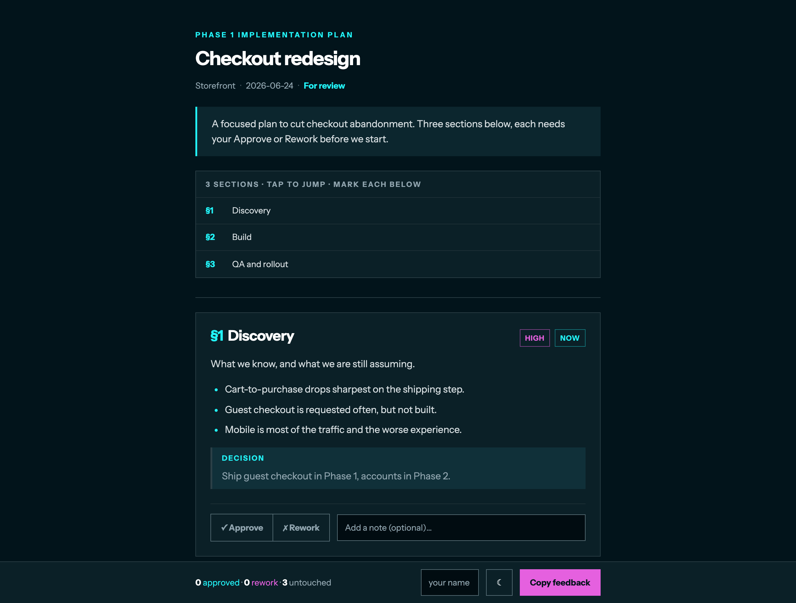

# reviewdoc

Turn any markdown plan, spec, or direction into one **self-contained, mobile-friendly HTML review document** with per-section **Approve / Rework** feedback, instead of asking someone to read raw markdown.

Built for the age of coding agents: your agent writes plans as `.md`, and you render them into something a human can actually review and sign off on, from a phone.



## Why

AI agents write plans, specs, and audits as markdown files. Perfect in the terminal, unreadable to anyone who has to approve them. reviewdoc renders that markdown into a designed HTML doc where each `##` section gets Approve/Rework buttons and a note field. The reviewer taps through, hits **Copy feedback**, and pastes one section-keyed block back to the agent, which revises exactly those sections.

The markdown stays your source of truth. The HTML is the human-facing review layer.

## Requirements

Python 3.10 or newer and one package, `markdown-it-py` (listed in `requirements.txt`). Fonts are bundled. Opening the result in a browser works on any OS; on macOS it tries a new window in your default browser.

## How it works

1. `build.py` reads your markdown file and splits it on `##` headings. Text before the first `##` becomes the cover lead.
2. Each `##` section is rendered with markdown-it-py (CommonMark plus tables) into a card with Approve and Rework buttons and a note field. A section map at the top links to every card.
3. The fonts are embedded as base64 and the page script is inline, so the output is one `.html` file with no network needs.
4. In the browser, your marks and notes are saved in `localStorage`, keyed to that document. **Copy feedback** turns them into one text block you paste back to the author.

## Install

```bash
git clone https://github.com/nikitazhylkin/reviewdoc.git
cd reviewdoc
pip install -r requirements.txt        # one dependency: markdown-it-py. Python >= 3.10
```

## Use

```bash
python3 build.py examples/sample-plan.md          # renders + opens sample-plan.html
python3 build.py my-plan.md -o review.html --no-open
```

Options: `-o <path>` sets the output file (default: next to the source, with `.html`). `--no-open` skips opening the browser. Set `$REVIEWDOC_BROWSER` to choose which browser opens.

The output is one self-contained `.html` (fonts embedded, works offline). AirDrop it or send it as a file; it opens on a phone.

## Use it with a coding agent

**As a Claude Code skill.** Drop this folder in `~/.claude/skills/reviewdoc/`. Now tell Claude *"make a review doc"* and it renders your plan and opens it automatically. `SKILL.md` defines the trigger and the authoring conventions.

**As a one-line ask to any agent.** Hand `build.py` to any coding agent with one instruction:

> render my plan markdown as a self-contained HTML review doc, one card per heading, Approve/Rework plus a Copy feedback button that emits a section-keyed block.

## Authoring

- `##` = a review section (card + Approve/Rework). `###` = a subsection inside the card.
- Optional frontmatter: `title`, `subtitle`, `project`, `date`, `status`.
- Heading chips: `## Build {priority=high status=now}`.
- Callouts: `> [!decision]` / `[!risk]` / `[!question]` / `[!note]`.
- Keep bullets and paragraphs short (aim for 4 lines or fewer) so it reads on a phone.

See [`examples/sample-plan.md`](examples/sample-plan.md) for a full example.

## The feedback block

Each section has Approve / Rework plus a note (saved per-device in `localStorage`). **Copy feedback** emits:

```
Review: <title> · <reviewer>
§2 Build   ✗ rework — "split into 2a/2b"
§4 QA      ✓ approve
```

The reviewer name comes from the name field on the page. Sections with no mark and no note are left out of the block.

Paste it back to your agent; it revises the exact sections named.

## Theme

The whole look (cyan `#00F0F4` / magenta `#E560DF` editorial, Instrument Sans + Inter, dark + light) lives in the `TEMPLATE` string in `build.py`. It is the DigX house style. Change the color vars in one place to rebrand it as your own.

## Fonts

Instrument Sans and Inter are bundled under the SIL Open Font License 1.1 (see [`assets/fonts/OFL.txt`](assets/fonts/OFL.txt)).

## Tests

```bash
pip install pytest
python3 -m pytest tests/ -q
```

## License

MIT. Built by [@Niki_Builds](https://x.com/Niki_Builds).
